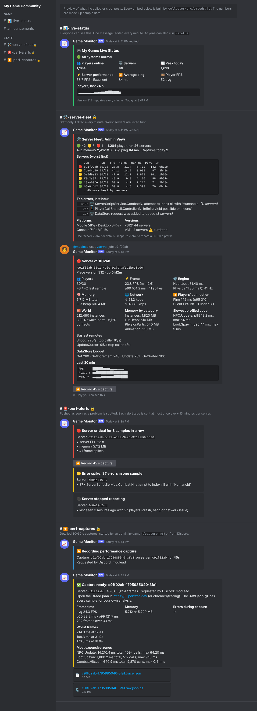

# Roblox Server Analytics

Always-on performance monitoring for Roblox servers, admin-triggered 30–60 s detailed captures, and a Discord bot that shows the data to players and staff.

```
Roblox servers ──HTTPS (batched, every 30 s)──▶ collector (Node + SQLite) ──▶ Discord bot
   ▲                                               │   public status / admin fleet / alerts / captures
   └──── Open Cloud MessagingService ◀─────────────┘   (/capture from Discord)
```

Discord blocks requests that come straight from Roblox servers, so the collector sits in between. It also stores the history and builds the trace files.



See also `docs/discord-preview.html`.

## What gets collected

**Always on (every 5 s, uploaded every 30 s)**

| Area | Metrics |
|---|---|
| Frame | server FPS avg/min, p99 & max frame time, frames > 33 ms, `Stats.HeartbeatTimeMs` |
| Physics | `PhysicsStepTimeMs`, real physics FPS, primitives, moving primitives, contacts, awake parts |
| Memory | total, Lua heap (`gcinfo`), every `Enum.DeveloperMemoryTag` category |
| Network | data & physics send/receive kbps |
| World | instance count, StreamingEnabled |
| DataStores | remaining request budget per request type |
| Players | count, joins/leaves, avg session length, server-measured ping avg/p95 |
| Clients | FPS, client memory, platform mix (Desktop/Mobile/Console/VR), quality level, client errors |
| Errors | server errors (grouped, with source + stack), warning count |
| Custom | your counters/gauges/timings, `Analytics.profile` zones, RemoteEvent call rates & spammy callers |
| Lifecycle | server start, clean shutdown, and "stopped reporting" (possible crash) |

**Detailed capture (30–60 s, on demand).** This records every frame: frame time, the PreSimulation→PostSimulation span, heartbeat/physics time and Lua heap. It also records every `Analytics.profile` zone and timestamped errors. Every 0.5 s it adds memory by category, network, physics counts and pings. The collector turns the capture into:
- `<id>.trace.json`: open in **https://ui.perfetto.dev** or `chrome://tracing`, which gives a frame timeline, zone flame track, counter graphs and error markers
- `<id>.raw.json.gz`: every sample, for your own scripts or notebooks

### About the real MicroProfiler
Scripts can't start, read or export Roblox's MicroProfiler, so no module can save one automatically. This system gets as close as the engine allows:
1. The capture above records everything scripts can measure, each frame, uploads it and posts it to Discord.
2. Every `Analytics.profile("Name", fn)` zone also calls `debug.profilebegin/profileend`, so the same labels show up in a real MicroProfiler dump.
3. To take a real dump of a live server: join the server as an admin, press **F9**, open **MicroProfiler**, choose **Server**, set frames/sec and seconds, then **Start Recording**. The `.html` dump is saved locally and you can share it in `#perf-captures`. The **Script Profiler** tab (Server mode) can also export a JSON CPU profile.

## Roblox setup

Files are laid out for Rojo (`default.project.json`). To set up by hand in Studio instead:

| File | Create as |
|---|---|
| `roblox/Analytics/init.lua` | ModuleScript **Analytics** in ServerScriptService |
| `roblox/Analytics/Config.lua`, `Util.lua`, `Transport.lua`, `DetailedCapture.lua` | ModuleScripts *inside* Analytics |
| `roblox/Analytics/Collectors/*.lua` | Folder **Collectors** inside Analytics, with one ModuleScript per file |
| `roblox/AnalyticsBootstrap.server.lua` | Script in ServerScriptService |
| `roblox/AnalyticsClient.client.lua` | LocalScript in StarterPlayer › StarterPlayerScripts |

1. **Game Settings › Security › Allow HTTP Requests**: turn on.
2. **Creator Hub › your experience › Secrets**: add `analytics_key` with the same value as `INGEST_KEY`, with its domain set to your collector's host.
3. Edit `Config.lua`: set `Endpoint`, and add admin user ids or a group/rank. The experience owner is always an admin.
4. Optional instrumentation:

```lua
local Analytics = require(game.ServerScriptService.Analytics)

RunService.Heartbeat:Connect(function(dt)
	Analytics.profile("NPC.Update", updateNpcs, dt)   -- timed, shows in captures and MicroProfiler
end)
Analytics.trackRemote(ReplicatedStorage.Remotes.Shoot) -- call rate + spam detection
Analytics.increment("RoundsStarted")
Analytics.gauge("ActiveNPCs", #npcs)
Analytics.event("BossDefeated", { seconds = 312 })
```

**In-game admin commands:** `/capture [30-60]` starts a capture on the current server. `/perf` shows quick stats. Admins get chat notices when a capture starts and when its upload finishes.

Limits it respects: HttpService allows about 500 requests per minute per server. This system uses about 2 per minute, plus about 8 per capture, with its own 60 per minute cap. If the collector is down, records are queued in memory, up to 500.

## Collector + Discord bot

Requires Node ≥ 22.13 (it uses the built-in `node:sqlite`, so there are no native dependencies).

```bash
cd collector
cp .env.example .env      # fill in INGEST_KEY and the Discord / Open Cloud values
npm install
npm start
npm test                  # end-to-end test with simulated servers
```

Host it anywhere with a public HTTPS URL (Fly.io, Railway, a VPS behind Caddy, and so on).

**Discord app:** create an application, add a bot and invite it with the `bot` and `applications.commands` scopes. It needs *Send Messages*, *Embed Links* and *Attach Files* in the four channels. Put the channel ids, guild id and staff role id in `.env`.

| Channel | Who sees it | Content |
|---|---|---|
| `#live-status` | everyone | one embed edited every minute: players, servers, peak today, server FPS, ping, player FPS, 24 h sparkline |
| `#server-fleet` | staff | per-server table (worst first), top errors, platforms, outdated versions |
| `#perf-alerts` | staff | critical for 3 samples in a row, error spikes, servers that stopped reporting, each with a **Record 45 s capture** button |
| `#perf-captures` | staff | capture started / finished with a summary, plus the trace and raw files attached |

Slash commands: `/status` (everyone), plus `/servers`, `/server <job>`, `/errors [minutes]` and `/capture <job> [seconds]` (staff, with job id autocomplete).

**Discord-triggered captures** need an Open Cloud API key with the *Messaging Service › publish* permission for your universe (`ROBLOX_OPEN_CLOUD_KEY`, `ROBLOX_UNIVERSE_ID`).

The collector also has `GET /api/overview` and `GET /api/servers`, which use the same bearer key, if you later want a web dashboard or Grafana (JSON API data source).

## Privacy
User ids are **not** sent by default (`Config.IncludeUserIds = false`); only aggregate player stats are. Data is deleted after `RETENTION_DAYS`, which defaults to 14.
